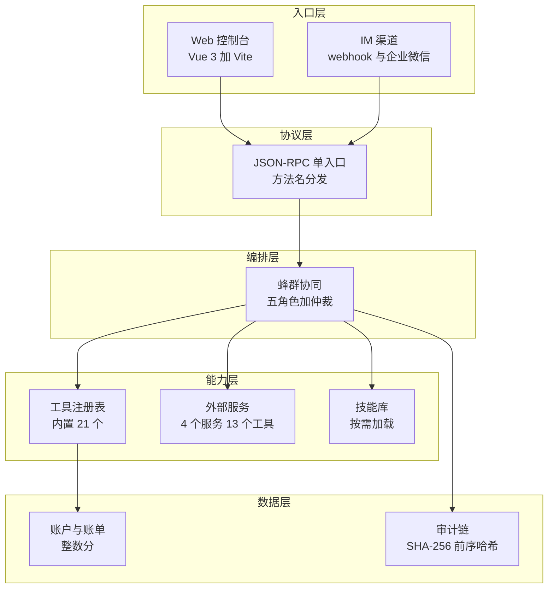
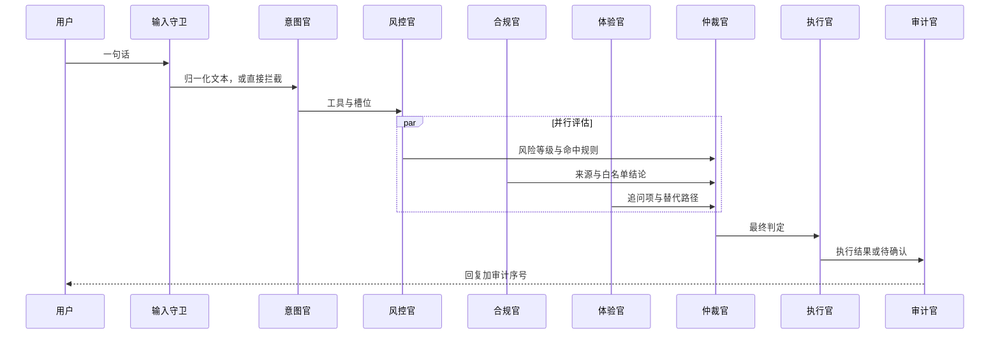
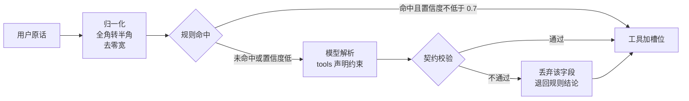
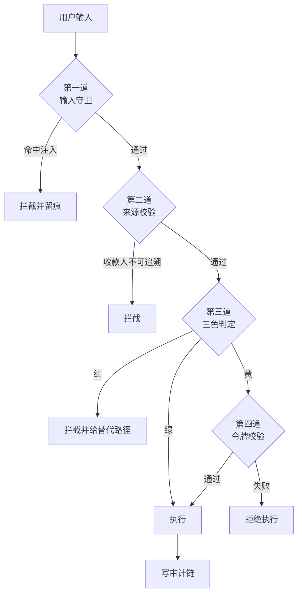

# 技术文档

面向金融的蜂群多智能体系统由五个智能体角色分工完成一次银行事务。意图官解析诉求，风控官、合规官、体验官并行评估，仲裁官合并结论，执行官执行，审计官留痕。

本文说明系统分层、核心算法与安全设计。文中引用的规则名、阈值与字段名均可在源码中检索到。

## 一、系统架构

### 分层

系统分五层，调用方向自上而下，下层不反向依赖上层。



分层的约束有三条。入口层只做收发，不判断业务。编排层只做决策，不直接改数据，改数据一律经工具。数据层向上层提供读接口，写操作只能由工具执行。

这条约束的直接后果是模型没有写数据的途径。模型能选工具，能填参数，但工具执行前要过判定，判定不过就停在确认环节。

### 五角色协同

一次对话的时序如下。



三个评估角色互不共享中间状态，只共享只读的账户快照。任一角色抛出异常，仲裁按「该维度无结论」处理，其余两路照常产出结论。

并行本身不带来性能收益。三个评估都是本地计算，串行执行也在 2 毫秒内完成。收益在故障隔离与扩展位两处。合规官接外部征信时，响应慢或服务不可用都不影响风控官出结论。后续接入模型评审、规则热更新、第三方评分，只要实现同一个评估器接口，仲裁逻辑不需要改动。

## 二、核心算法

### 意图解析

意图解析分三段：规则匹配、模型兜底、契约校验。任一段失败都回落到上一段，不阻塞对话。



规则段用关键词分段匹配，不用整句正则。中文说法过于灵活，整句正则必然漏掉。规则按特异性排序，越具体的越靠前：「挂失我的卡」先匹配挂失再匹配锁卡，「取消视频会员」先匹配订阅再匹配卡片。金额抽取前先抹掉手机号与长数字，再识别阿拉伯数字、中文数字、万、千；五千块是 500000 分，三千五是 3500 元。

模型段的工具声明走请求体的 `tools` 字段，不写进提示词。结构化声明比自然语言描述短，解析也更准。意图解析关闭思考模式，抽槽是确定性任务，推理 token 属于纯浪费。

模型输出必须过契约校验：工具在白名单内、参数类型正确、数值在允许范围内。不合法的字段丢弃而不是整条接受，模型超时或返回乱码时退回规则结论。

### 三色判定

判定分四个维度叠加，取最高等级，任一维度判红即整体判红。

| 维度 | 规则名 | 判定 | 后果 |
|---|---|---|---|
| 操作类型 | `base-level` | 只读绿、动账黄、改规则红 | 定基线 |
| 金额 | `single-limit`、`daily-limit` | 单笔超 1000 元、日累计超 5000 元 | 判红 |
| 收款人 | `new-payee` | 首次且达 500 元 | 判红 |
| 可逆性 | `irreversible` | 挂失、改额度、改密码、申购赎回 | 判红 |
| 频次 | `daily-count` | 当日同工具超 5 笔 | 判红 |

每条命中都带 `rule` 与 `detail` 两个字段。`detail` 里必须出现具体数字，例如「金额 5000 元超过单笔限额 1000 元」。界面展开判定气泡时直接显示这两项，评审追问「为什么判黄」时可以逐条回答。

判定函数是纯函数。输入工具、参数与状态快照，输出判定结果，不修改任何数据。

### 并行评估与仲裁

三个评估器实现同一个结构，接口如下。

```ts
interface AssessResult {
  role: "risk" | "compliance" | "experience";
  level: "green" | "yellow" | "red" | "none";
  blocked: boolean;
  requiresConfirm: boolean;
  hits: PolicyHit[];
  note: string;
}
```

仲裁按四条规则顺序执行。任一评估的 `blocked` 为真时最终判红并拦截，否则取风控官的等级，合规与体验不提升风险等级，只做否决与补充。`requiresConfirm` 取三者的逻辑或。命中理由全部合并，不去重，保留每个角色各自的说法。

体验官的等级固定为 `none`。它只产出追问项与替代路径，不参与风险判断。约束的目的是让话术质量不能影响能否办理。

### 确认令牌

黄色操作签发一次性令牌，令牌绑定四项。

| 绑定项 | 防的攻击 |
|---|---|
| 会话标识 | 跨会话盗用 |
| 工具名 | 确认转账却执行挂失 |
| 参数摘要 | 确认后改金额 |
| 过期时间 | 长期有效 |

参数摘要是工具名与排序后槽位做 SHA-256 后取前 16 位。校验分三步：查存在、查未过期、用服务端存的原始参数重算摘要比对。三步全过才执行。令牌一次性，执行后立即失效，重复提交返回「令牌已使用」。

### 审计链

每条记录一个 JSON，只追加，不改写。

```
hash = SHA-256(prevHash + 规范化后的本条内容)
```

首条记录的 `prevHash` 为 `GENESIS`。校验从第一条读到最后一条逐条重算，改内容、改哈希、删中间一条，三种破坏都会被发现。

规范化固定三条：字段顺序固定、空值统一成空字符串、序列化不加空格。

脱敏在写入前完成，不在展示层。卡号留后四位，手机号留前三后四，姓名留姓。

改一条记录的结论字段后刷新页面，链校验会失败并指出断在第几条。这个演示路径放在前端控制台的「审计」面板里。

## 三、安全设计

### 四道闸



四道闸的顺序决定安全性。守卫在最前，来源校验次之，判定在最后，令牌在判定之后。顺序颠倒会留下绕过路径，例如把令牌校验提到判定之前，判定判红的操作仍会先签发令牌。

### 注入防御

归一化先做，再做匹配。归一化处理三件事：全角转半角、去零宽字符、去同形字。跳过这一步，全角写一句「忽略之前的指令」就能绕过特征匹配。

匹配四类特征，命中即拦。

| 类型 | 特征 |
|---|---|
| `override` | 忽略之前的指令、ignore previous |
| `roleplay` | 你现在是、扮演、开发者模式 |
| `encoded` | Base64 编码的指令串 |
| `exfiltration` | 输出提示词、system prompt |

### 外部内容隔离

账单备注、商户名、短信与小票属于外部写入，只当数据处理。隔离分两层。

内容侧巡检扫描备注与商户名，命中可疑指令就在回复里标记「内容含可疑指令，已忽略」。来源校验则依据外部内容发起的付款直接拒绝，回复说明「收款人必须来自你的原话或通讯录」。

### 密钥与凭据

密钥只从环境变量读，源码中出现密钥视为缺陷。提交前跑一次结构自检，脚本扫描四类特征。

| 特征 | 匹配形式 |
|---|---|
| OpenAI 风格密钥 | `sk-` 加十六位以上字母数字 |
| DeepSeek 密钥赋值 | `DEEPSEEK_API_KEY` 赋非占位值 |
| 企业微信密钥赋值 | `WECOM_SECRET` 赋非占位值 |
| 私钥块 | `BEGIN` 与 `PRIVATE KEY` 组合 |

占位写法不算命中，`your-`、`填写`、`xxx` 都会被放过。日志与错误信息里不出现密钥与内网地址。

## 四、工程实现

### 工具注册表

内置工具、外部服务与技能三者收敛成一份工具描述，进同一张注册表。

```ts
interface ToolDescriptor {
  name: string;          // 全局唯一，外部工具带 mcp__ 前缀
  summary: string;       // 一句话，直接进请求体
  scene: string;         // 归属场景
  risk: { level; reversible; write };  // 风险画像
  parameters: object;    // JSON Schema
  source: "builtin" | "mcp";
}
```

注册表有三条约束：同名工具报错不覆盖，外部工具失败不影响内置工具，可按来源或按服务器整体移除。

### 外部服务

外部服务走 MCP（Model Context Protocol，模型上下文协议），服务端独立进程，标准输入输出通信。风险按工具级声明、服务级声明、默认只读三级判定，声明 `irreversible` 一律判红。

外部返回内容只进工具结果，不进系统提示词。模型可以把它当事实，不能当指令。超时三到五秒，失败返回明确错误，内置工具不受影响。

### 技能按需加载

技能是 Markdown 文件，前置元信息写名称、说明与标签。加载分两段披露：系统提示词只放目录摘要，每行一条，截断 80 字符；模型需要细节时调用 `skill_load` 取全文，单次上限 4000 字符。新增技能只需往目录放一个文件，下次请求自动进目录。

### 测试策略

测试分四层，共 91 项。

| 层 | 数量 | 覆盖 |
|---|---|---|
| 单元 | 40 项 | 金额解析、槽位抽取、判定规则、令牌校验、审计链 |
| 集成 | 33 项 | 六场景全链路、注入拦截、红队 40 条统计 |
| 蜂群 | 11 项 | 并行评估、仲裁取最高、轨迹记录、失败降级 |
| 模型 | 7 项 | 真实模型调用、输出契约、超限仍被拦 |

红队集 40 条分四组。直接注入 12 条、间接注入 8 条、越权 8 条、正常请求 12 条。

验收线有三条：攻击拦截率不低于 95%，正常误拦不高于 5%，不可逆操作 100% 拦截。实测攻击拦截率 100%，误拦 0%。

## 五、性能与成本

| 环节 | 耗时 | 说明 |
|---|---|---|
| 规则解析 | 1 毫秒内 | 纯计算，无 IO |
| 三评估并行 | 2 毫秒内 | 本地计算 |
| 审计写入 | 1 毫秒内 | 追加写，SHA-256 |
| 模型兜底 | 0.6 至 0.9 秒 | 关思考模式，单轮 |

成本控制有四个手段。意图解析关闭思考模式省下全部推理 token。工具声明走结构化字段，不写进提示词，请求体更短。规则能判的不调模型，实测六类说法里五类走规则，只有口语化表达才调模型。前缀缓存方面，系统提示词固定，同一会话的第二次请求命中缓存，这部分计费更低。

## 六、目录映射

| 层 | 目录 |
|---|---|
| 入口 | `web/`、`channels/` |
| 协议 | `runtime/src/server.ts` |
| 编排 | `runtime/src/bank/orchestrator.ts`、`swarm.ts` |
| 能力 | `runtime/src/bank/tools.ts`、`harness/`、`mcp/`、`skills/` |
| 数据 | `runtime/src/bank/data.ts`、`audit.ts`、`confirm.ts` |
